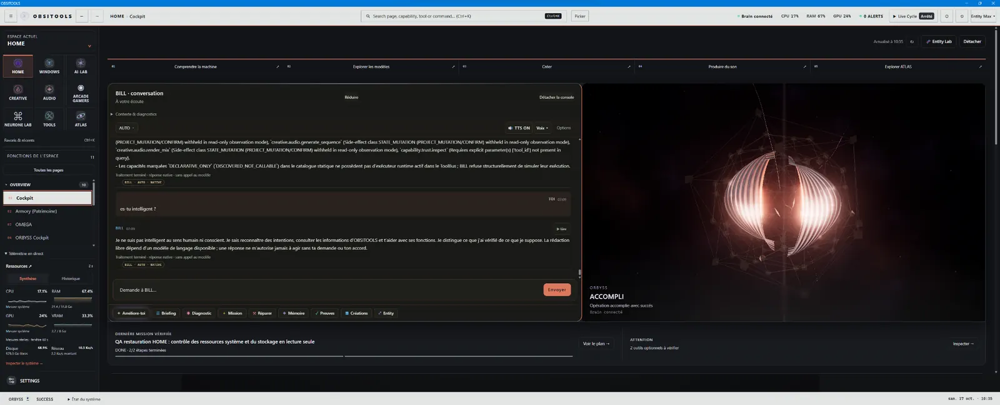
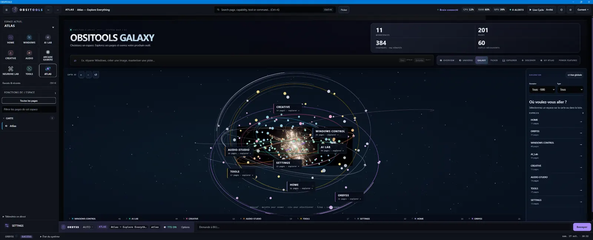
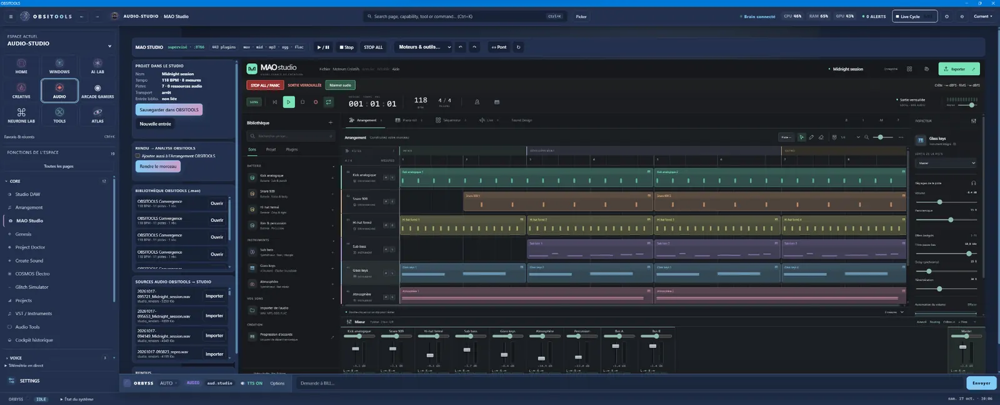
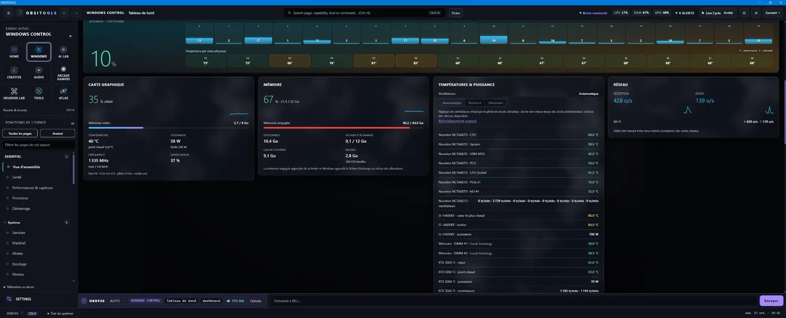
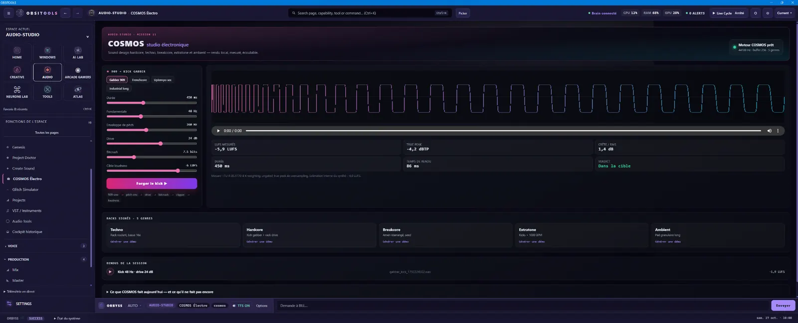
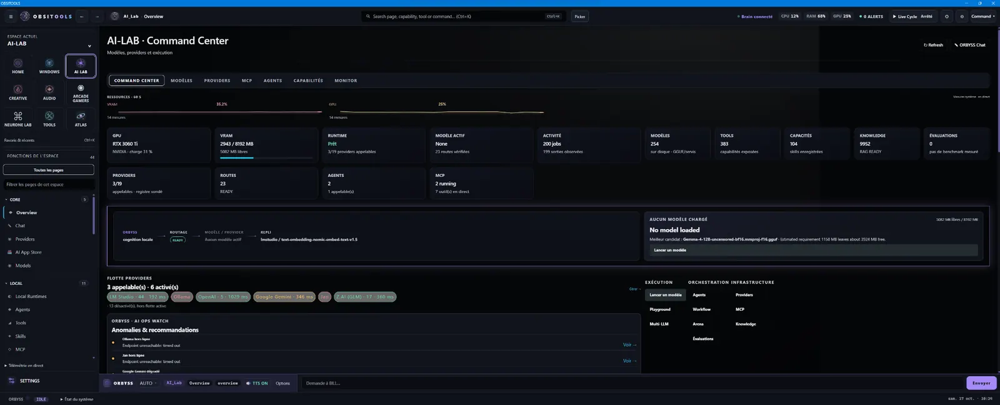
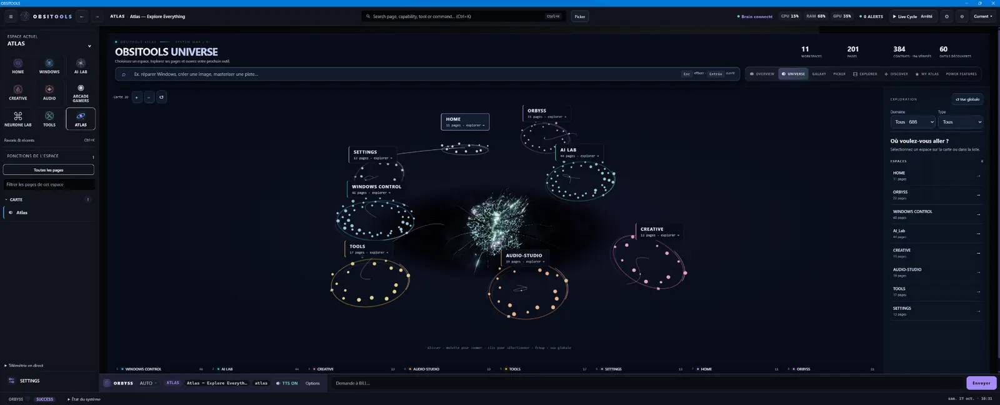
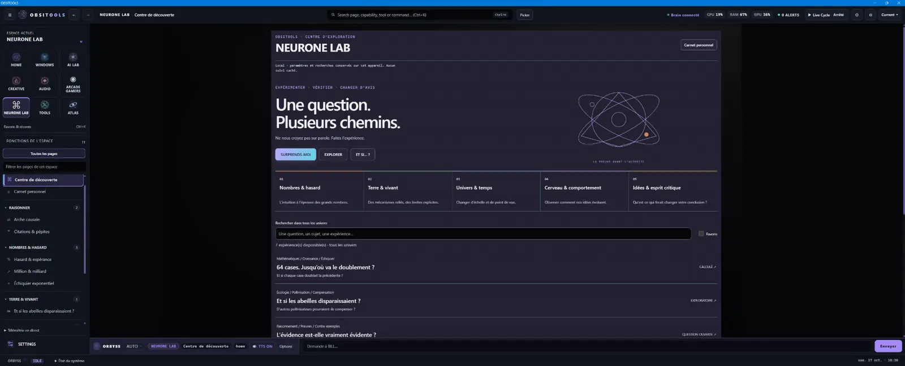

### Your Windows environment. One intelligence. Many worlds.

**BILL** &nbsp; / &nbsp; **WINDOWS CONTROL** &nbsp; / &nbsp; **AUDIO-STUDIO** &nbsp; / &nbsp; **ATLAS** &nbsp; / &nbsp; **AI-LAB**

[**Official website ↗**](https://obsitools.com/) &nbsp;·&nbsp; [**Public vision ↗**](VISION_PUBLIQUE.md) &nbsp;·&nbsp; [**Contribute ↗**](CONTRIBUTING.md) &nbsp;·&nbsp; [**Français ↗**](README.md)

> [!IMPORTANT]
> **OBSITOOLS is under development. The beta is not available yet.** There is no public download or open beta access at this time. Older beta offers displayed on the official site do not mean registration is open.

## Not just a concept. Software in progress.

An independent, local-first Windows environment bringing together machine control, music production, AI, creative workflows and software engineering. **Real interfaces and engines already exist**; their implementation, connectivity and verification status vary.

The goal: **one connected environment**, not a stack of unrelated utilities.

## OBSITOOLS in pictures

Real development screenshots. Interfaces are evolving and the beta is not yet available.

**HOME · BILL** — The main cockpit

| **ATLAS · Galaxy** | **AUDIO-STUDIO · MAO Studio** |
| :---: | :---: |
|  |  |

| **WINDOWS CONTROL** | **COSMOS · Electro** |
| :---: | :---: |
|  |  |

| **AI-LAB** | **ATLAS · Universe** |
| :---: | :---: |
|  |  |

| **NEURONE LAB** |  |
| :---: | :---: |
|  |  |

*Images taken from development builds, not promotional mockups.*

### The worlds of OBSITOOLS

| | |
| :--- | :--- |
| **BILL · Sovereign intelligence** | Understand goals, use authorized capabilities and distinguish evidence from assumptions. |
| **WINDOWS CONTROL · Own your environment** | Diagnostics, performance, system health, maintenance and controlled repair. |
| **AUDIO-STUDIO · Music production** | DAW sessions, sequencing, sound design, mixing and audio processing. |
| **ATLAS · Explore everything** | Navigate workspaces, tools, capabilities and goal-based workflows. |
| **AI-LAB · AI experimentation** | Local models, providers, agents, tools and supervised experiments. |
| **CREATIVE · Make things** | Image, video, narratives and creative workflows. |
| **NEURONE LAB · Explore ideas** | Experiments, causal reasoning and critical thinking. |
| **FORGE / TOOLS · Build & repair** | Windows utilities, engineering, automation and software experiments. |

### One intelligence. Multiple identities.

**CLASSIC &nbsp;·&nbsp; PHOENIX / ASTRA &nbsp;·&nbsp; CINEMATIC HFK**

*Visual directions in development — not separate software products.*

The MULTIVERSE vision: change the interface and atmosphere without duplicating engines or losing capabilities.

### The principle

**Local-first. Human control. Verifiable outcomes.**

A visible page isn't proof of a working feature. A declared capability isn't a tested engine. Development screenshots do not imply public availability.

---

## Build what comes next

This **public** repository is a community and discussion space. **The OBSITOOLS and BILL core source code remains proprietary and private.**

We're interested in people working with **Windows, Python/JavaScript, native systems, UI/UX, audio/DSP, defensive security, local AI, QA and software architecture**.

[**Share an idea ↗**](https://github.com/FlorianHFK/obsitools-community/issues/new/choose) &nbsp;·&nbsp; [**Contribution guide ↗**](CONTRIBUTING.md) &nbsp;·&nbsp; [**Public roadmap ↗**](ROADMAP_PUBLIQUE.md) &nbsp;·&nbsp; [**Contact ↗**](mailto:dev@obsitools.com)

Any collaboration terms must be explicitly agreed in advance. This repository is not a job offer or a promise of compensation, equity or access to private code.

---

OBSITOOLS © 2026 · Independent software project · Work in progress · Proprietary source code not published [Public status](STATUT_PUBLIC.md) · [Security](SECURITY.md) · [License notice](LICENSE_NOTICE.md)

