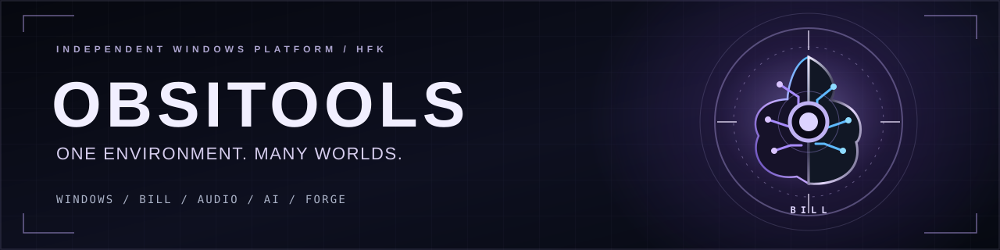

### Un environnement Windows. Plusieurs mondes. Une intelligence souveraine.

**Windows Control · BILL · AUDIO-STUDIO · ATLAS · AI-Lab · Creative · Engineering**

[**Découvrir le projet ↗**](https://obsitools.com/) &nbsp;·&nbsp; [**Explorer la présentation ↗**](./index.html) &nbsp;·&nbsp; [**Participer ↗**](./CONTRIBUTING.md) &nbsp;·&nbsp; [**English ↗**](./README.en.md)

> [!IMPORTANT]
> **OBSITOOLS est en développement. La bêta n'est pas encore disponible.** Aucun téléchargement public ni accès bêta ouvert actuellement. Les anciennes annonces sur le site officiel ne constituent pas une ouverture de la bêta.

## Une plateforme, pas une collection de fenêtres

**OBSITOOLS** est un projet indépendant pour Windows qui rassemble diagnostic système, création musicale, ingénierie, exploration et intelligence artificielle dans un environnement conçu pour rester sous le contrôle de son utilisateur.

Au cœur du projet, **BILL** : une intelligence souveraine en développement, pensée pour comprendre un objectif, utiliser des capacités autorisées et distinguer un résultat vérifié d'une simple promesse.

Le projet possède déjà des interfaces et des modules en développement actif. **Leur maturité varie** : toutes les fonctions présentées ne sont pas nécessairement disponibles, connectées ou finalisées.

## Aperçu du produit

Des vues issues du développement réel d'OBSITOOLS. Les captures peuvent représenter des versions de travail et ne constituent pas une démonstration de disponibilité commerciale.

| HOME — Cockpit | Windows Control |
| :---: | :---: |
|  |  |
| **BILL et navigation entre les espaces** | **Télémétrie et diagnostics système** |

| AUDIO-STUDIO — Fractal Temporal Glitch | NEURONE LAB — Arche causale |
| :---: | :---: |
|  |  |
| **Expérimentation audio et transformation du son** | **Explorer des relations et leurs conséquences** |

> Les images correspondent à des captures de développement, pas à un produit public téléchargeable. Des visuels plus récents viendront les remplacer.

## Les territoires OBSITOOLS

| Espace | Ambition |
| --- | --- |
| **BILL** | Intelligence locale et orchestrations autorisées, avec preuves et contrôle humain. |
| **WINDOWS CONTROL** | Comprendre, diagnostiquer et maîtriser son environnement Windows. |
| **AUDIO-STUDIO** | Composition, traitement du son, workflows DAW, DSP et mastering. |
| **ATLAS** | Explorer et organiser les outils et les capacités sans se perdre dans les menus. |
| **AI-LAB** | Modèles, fournisseurs, expérimentation IA et environnements de travail. |
| **NEURONE LAB** | Expériences, raisonnements, liens causaux et exploration d'idées. |
| **FORGE / TOOLS** | Créer, analyser, réparer et faire évoluer des outils logiciels. |

## Plusieurs identités visuelles, un seul produit

OBSITOOLS explore des interfaces adaptables à des usages très différents : poste de travail professionnel, espace de création, laboratoire et centre de commandement immersif. L'objectif est de partager les mêmes données et fonctions sans dupliquer les moteurs.

**Local-first · Souveraineté · Ergonomie premium · Vérification des résultats · Évolution sans régression**

## Construisons la suite

Ce dépôt est **l'espace communautaire public** du projet, pas son code source.

Nous souhaitons échanger avec des personnes qui aiment construire des produits exigeants : développement Python / JavaScript / natif, systèmes Windows, sécurité défensive, audio / DSP, UI/UX, QA et documentation.

**[Proposer une idée](https://github.com/FlorianHFK/obsitools-community/issues/new/choose)** · **[Lire la vision](./VISION_PUBLIQUE.md)** · **[Contribuer](./CONTRIBUTING.md)** · **[Écrire à dev@obsitools.com](mailto:dev@obsitools.com?subject=OBSITOOLS%20-%20Contribution)**

Ce dépôt ne constitue ni une offre d'emploi, ni une promesse de rémunération ou de parts. Les conditions de toute contribution significative sont à convenir explicitement au préalable.

---

**OBSITOOLS © 2026** · Projet indépendant en développement · Le cœur d'OBSITOOLS et de BILL reste propriétaire et privé. Aucun droit de réutilisation du code propriétaire n'est accordé par ce dépôt. [Sécurité](./SECURITY.md) · [Mentions de licence](./LICENSE_NOTICE.md)
