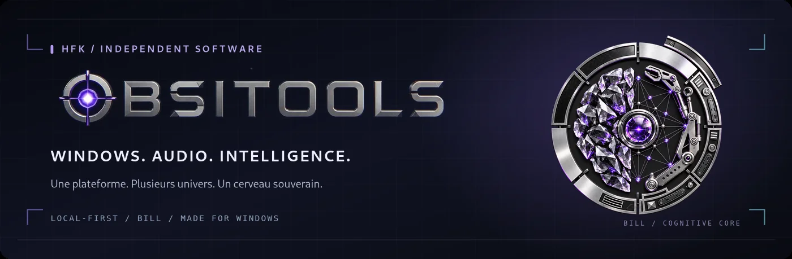
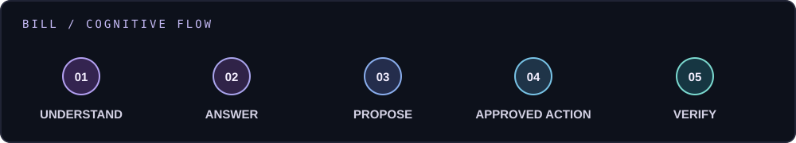
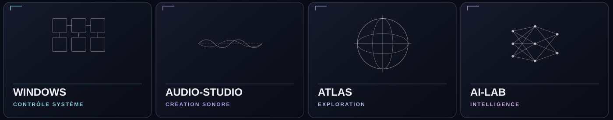

### UN PC. DES UNIVERS. UNE INTELLIGENCE QUI LES RELIE.

**OBSITOOLS imagine une autre manière de travailler sur Windows :****comprendre, créer, expérimenter et maîtriser — depuis un seul environnement.**

[**DÉCOUVRIR L’EXPÉRIENCE ↗**](https://florianhfk.github.io/obsitools-community/) &nbsp; · &nbsp; [**VOIR LE PRODUIT ↓**](#le-produit-en-images) &nbsp; · &nbsp; [**ENGLISH ↗**](README.en.md)

APPLICATION WINDOWS INDÉPENDANTE &nbsp; · &nbsp; LOCAL-FIRST &nbsp; · &nbsp; DÉVELOPPEMENT EN COURS

---

> [!IMPORTANT]
> **OBSITOOLS n'est pas encore disponible au téléchargement.** La bêta publique n'est pas ouverte. Cette page présente la vision du produit et des interfaces issues de versions de développement ; les capacités n'ont pas toutes atteint le même niveau de maturité. Ce dépôt est **la vitrine communautaire**, pas le code source propriétaire.

## Ce n'est pas un utilitaire Windows de plus.

**Et si votre ordinateur cessait d'être une juxtaposition d'outils sans lien ?**

OBSITOOLS est une plateforme de travail pour Windows qui fait converger des mondes généralement séparés : diagnostic et contrôle du système, production audio, exploration de ressources, IA locale, création et ingénierie.

L'objectif n'est pas de remplacer chaque logiciel spécialisé par une interface simplifiée. C'est de leur donner **un environnement commun, une navigation cohérente et un cerveau capable d'en comprendre les usages**, tout en préservant la puissance des outils.

| **MAÎTRISER** | **CRÉER** | **EXPLORER** |
|:--|:--|:--|
| Comprendre Windows, ses processus, ses services et ses incidents. | Manipuler l'audio, la MAO, les signaux et les workflows créatifs. | Relier connaissances, modèles, outils et expériences sans perdre le contexte. |

## BILL — pas une mascotte, le cerveau du produit.

**BILL (Brain Intelligence & Local Logic)** est conçu pour faire le lien entre l'intention de l'utilisateur et les capacités réelles d'OBSITOOLS. Sa doctrine est simple :

**Comprendre d'abord → répondre si possible → proposer si utile → agir uniquement sur demande ou autorisation → vérifier.**

- **Souveraineté locale :** privilégier les composants natifs et les traitements sur le PC, sans imposer un service cloud pour chaque tâche.
- **Intelligence extensible :** mobiliser, lorsque cela est utile et configuré, des modèles locaux ou des fournisseurs externes facultatifs.
- **Contrôle utilisateur :** distinguer une question d'un ordre, encadrer les opérations sensibles et montrer les résultats plutôt que promettre une action invisible.

BILL reprend un patrimoine technique et cognitif développé historiquement sous le nom **ORBYSS**. Certaines captures anciennes conservent cette appellation ; **BILL est le nom actuel du cerveau du produit**. L'intégration et les validations se poursuivent.

## Plusieurs univers. Une même plateforme.

 Illustrations conceptuelles issues du patrimoine graphique OBSITOOLS — elles ne sont pas des captures du logiciel.

| Univers | Ce que l'on y explore |
|:--|:--|
| **HOME & WINDOWS CONTROL** | Vue d'ensemble du PC, inspection système, maintenance, diagnostics et actions encadrées. |
| **AUDIO-STUDIO & COSMOS** | Production sonore, analyse DSP, outillage MAO et explorations audio créatives. |
| **ATLAS** | Navigation dans les espaces, ressources, outils et relations entre capacités. |
| **AI-LAB & BILL** | Modèles locaux, fournisseurs optionnels, expérimentations IA et orchestration guidée. |
| **CREATIVE & NEURONE LAB** | Création, pensée critique, expériences interactives et investigations intellectuelles. |
| **FORGE & TOOLS** | Ingénierie, automatisation, analyse et essais dans des conditions contrôlées. |

La plateforme conserve deux expériences complémentaires : **Ultimate_V2 / Web Premium** pour une interface moderne et **Full Python / Tkinter Powerhouse** pour les usages avancés. Elles partagent la même orientation produit et ne sont pas destinées à être fusionnées artificiellement.

## Le produit en images

**Des captures authentiques d'interfaces de développement**, pas des maquettes marketing. Cliquez sur les images pour les agrandir.

 01 / HOME — cockpit central &amp; espace BILL

<table>
<tr>
<td width="50%" align="center"> <strong>ATLAS / Exploration</strong></td>
<td width="50%" align="center"> <strong>AUDIO-STUDIO / Création</strong></td>
</tr>
<tr>
<td width="50%" align="center"> <strong>WINDOWS / Contrôle</strong></td>
<td width="50%" align="center"> <strong>AI-LAB / Intelligence</strong></td>
</tr>
</table>

> **Transparence visuelle :** certaines captures montrent des versions historiques et des mentions **ORBYSS**. Elles n'attestent pas, à elles seules, que toutes les fonctions présentées sont aujourd'hui livrées ou validées dans BILL.

## Une ambition exigeante, une livraison progressive.

OBSITOOLS repose sur un patrimoine logiciel déjà développé. L'effort actuel vise notamment **la consolidation des parcours réels, la qualité des interfaces, la fiabilité des opérations, l'intégration de BILL et la préparation d'une distribution Windows utilisable sur d'autres machines**.

Nous distinguons les **fonctionnalités présentes**, les **intégrations partielles**, les **expérimentations** et les **objectifs de développement**. Ni une jolie interface, ni l'existence d'un module dans le code ne suffisent à prouver un usage abouti.

**Aujourd'hui : développement actif · pas de bêta publique · pas de date de sortie annoncée.**

| Découvrir le projet | Comprendre sa progression |
|:--|:--|
| [Présentation communautaire ↗](https://florianhfk.github.io/obsitools-community/) | [État public du produit](STATUT_PUBLIC.md) |
| [Vision et philosophie](VISION_PUBLIQUE.md) | [Axes de développement](ROADMAP_PUBLIQUE.md) |
| [Questions fréquentes](FAQ.md) | [Participer et contribuer](CONTRIBUTING.md) |

## Construire la suite, ensemble.

OBSITOOLS est né comme un **projet indépendant**, avec une vision volontairement large : reprendre le contrôle de sa machine sans renoncer à la création, à l'exploration ou à l'intelligence.

Vous êtes sensible au **développement Windows, à l'audio/DSP, à l'IA locale, aux interfaces ambitieuses, à la sécurité défensive ou au test logiciel** ? Les retours, critiques argumentées et propositions de collaboration sont les bienvenus. Toute contribution technique se discute avant intervention sur le code propriétaire.

[**DÉCOUVRIR LA COMMUNAUTÉ ↗**](https://florianhfk.github.io/obsitools-community/) &nbsp; · &nbsp; [**CONTACTER LE PROJET ✉**](mailto:dev@obsitools.com) &nbsp; · &nbsp; [**LIRE LE GUIDE DE CONTRIBUTION ↗**](CONTRIBUTING.md)

 
OBSITOOLS © 2026 · HFK Independent Software · Produit propriétaire en développement · Aucun téléchargement public disponible

